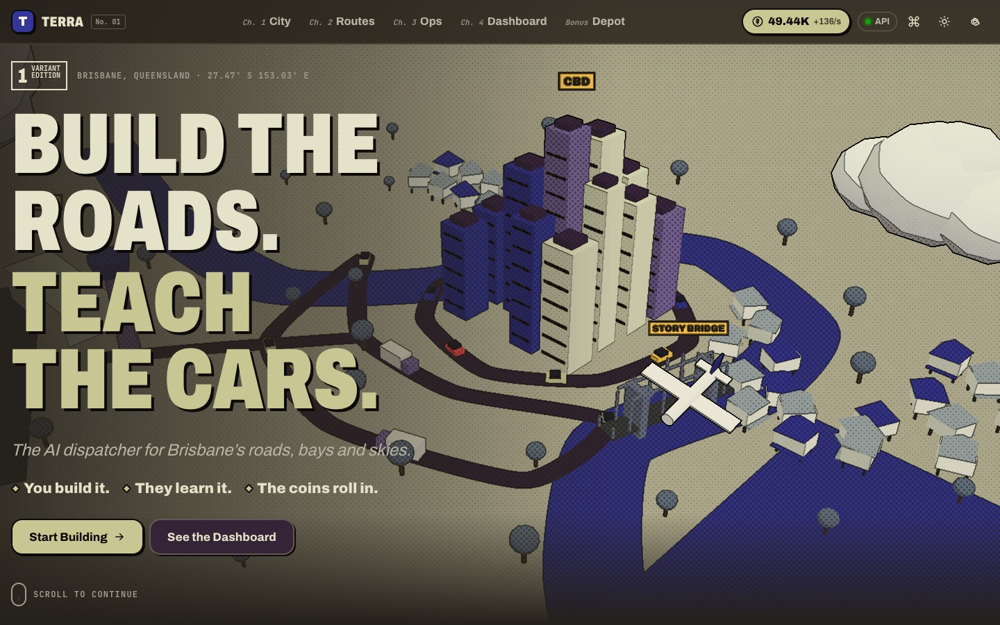
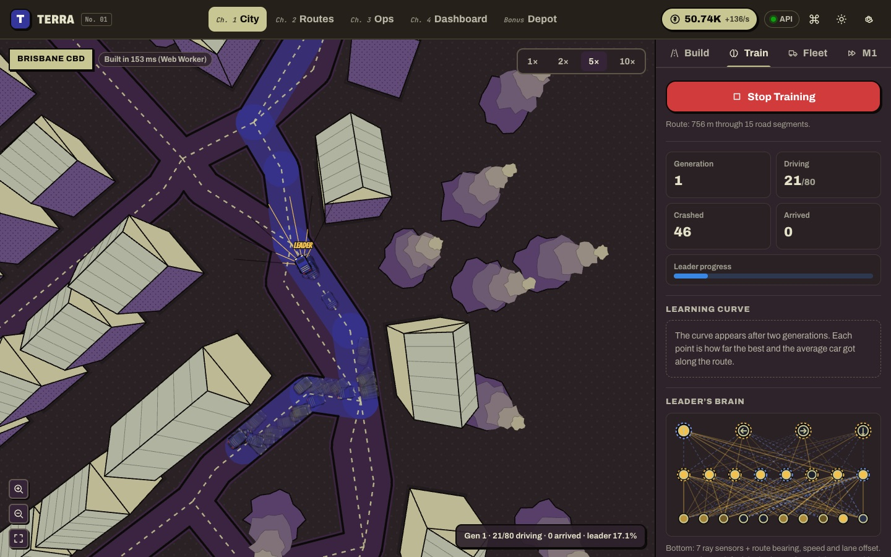
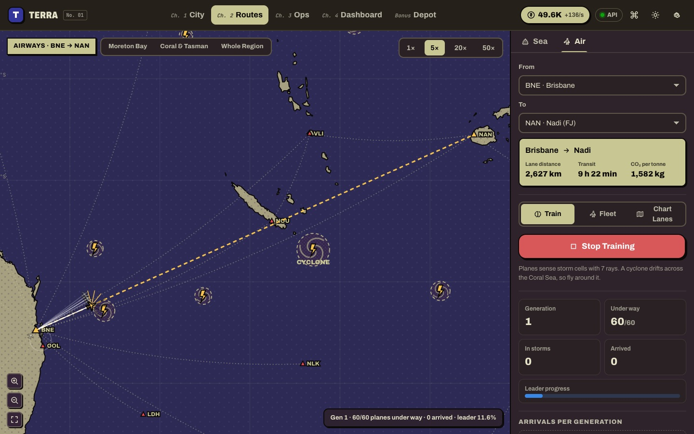
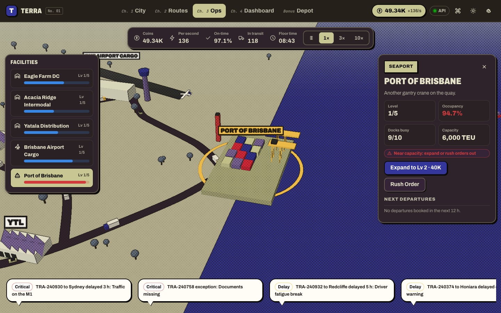
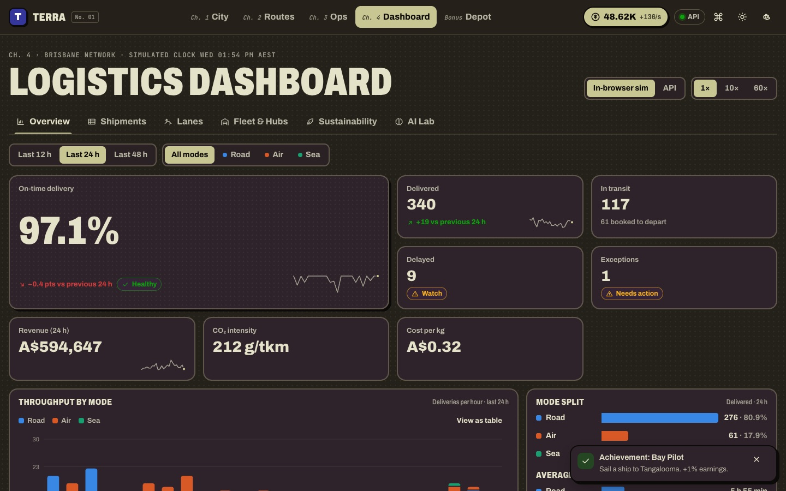
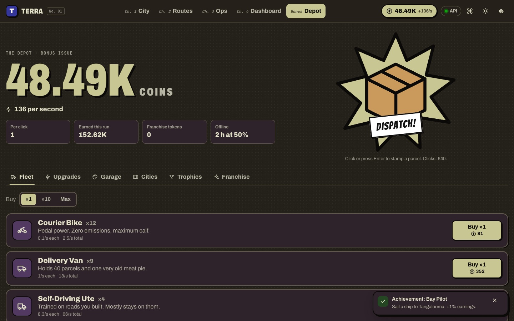
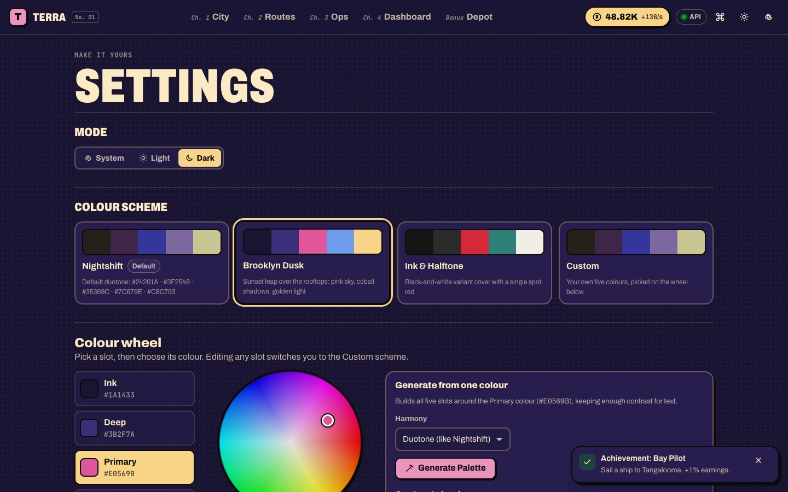
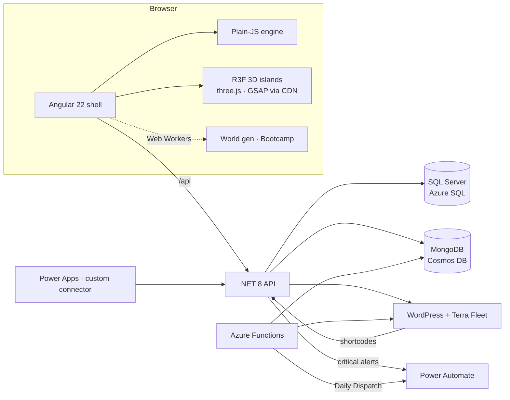

# Terra — Build the roads. Teach the cars.

**A comic-book logistics sim for Brisbane.** Draw roads over real city streets and watch self-driving cars learn to drive them. Chart sea lanes out of Moreton Bay and airways to the Pacific islands, then run the whole network from a live dashboard, a 3D strategy-game ops floor and an idle "Depot" that keeps earning while you're away.



| City Lab: cars learning a real Brisbane route | Air routes: freighters dodging a Coral Sea cyclone |
| --- | --- |
|  |  |
| **3D Ops: warehouses, the port and the airport** | **Logistics dashboard** |
|  |  |
| **The Depot (idle game)** | **Settings: presets, colour wheel, APCA contrast check** |
|  |  |

---

## What's inside

### Ch. 1 · City Lab (`/city`)
- **Build a virtual world in plain JavaScript.** Road graphs become rounded road envelopes, unioned road borders, lane guides, pseudo-3D buildings and trees, generated in a **Web Worker** (~150 ms for the Brisbane CBD).
- **Real streets.** Brisbane CBD, Surfers Paradise, Sydney CBD and the Melbourne Hoddle Grid come from OpenStreetMap; a Blank Sandbox lets you start from nothing; **Import OSM** loads any Overpass export.
- **Markings:** Start, Target, Stop, Give Way, traffic Lights (red lights block cars), Crossings and Parking, all snapped to lanes (left-hand traffic).
- **Self-driving cars that learn.** Each car has a small neural network fed by 7 ray sensors plus route bearing, speed and lane offset. A genetic algorithm keeps the best driver, mutates the rest with a spread of rates, adds crossover, and widens the search when a generation stagnates.
- **Fleet mode** deploys your best brain to a dozen cars on random routes (Dijkstra). Every delivery pays coins.
- **3D View** (`?view=3d`, or press **V**) renders the same world and the live cars in three.js with the comic ink-and-halftone post pass. Drag to orbit, right-drag to pan and scroll to zoom, like the Ops floor. The camera swoops in to trail the training leader, or a courier in Fleet mode. Editing stays on the 2D map: picking a tool switches back.
- **M1 Motorway:** the classic "dodge the traffic" trainer, themed Brisbane → Gold Coast, scored on cars overtaken.
- **Bootcamp (Web Worker):** trains a *generalist* in the background by scoring every brain on several routes per generation.
- **Brains:** save, download, import (validated) and sync to the cloud brain library.

### Ch. 2 · Sea & Air Routes (`/routes`)
- A comic chart of the South-West Pacific from Natural Earth coastlines: Moreton Bay detail through to Fiji, Vanuatu, New Caledonia, PNG, the Solomons, New Zealand and Bali.
- **Ships** learn to sail lanes you chart, using rays that sense the coastline. They must thread the North-West Channel without running aground. **Planes** learn to fly airways around drifting storm cells and a cyclone.
- **Chart your own lanes** with the same graph editor. Lanes that cross land are flagged in red, and ports stay fixed.
- A lane quote for each route (distance, transit time, CO₂ per tonne), plus a shipping-line or freighter **fleet mode** that pays coins.

### Ch. 3 · 3D Ops (`/ops`)
A **React Three Fiber** strategy-game view of three warehouses, the Port of Brisbane and BNE Airport Cargo. Trucks, ships and planes scale with your Depot fleet. It has occupancy bars, a day/night cycle, orbit and focus camera controls, an inspector with **Expand** (costs coins, +4% earnings per level) and **Rush Order** actions, and live alerts as speech bubbles. Everything is keyboard-operable from the facility list.

### Ch. 4 · Logistics Dashboard (`/dashboard`)
Industry-standard views over a deterministic simulation of the Brisbane network:
- **Overview:** on-time delivery (hero figure with delta and status), throughput by mode, hourly OTD, mode split, average transit, exceptions and alerts, a dock-schedule Gantt, and hub occupancy.
- **Shipments:** search, filter, sort and paginate (all URL state), a detail timeline, optimistic **Expedite**, and **CSV export**.
- **Lanes:** busiest lanes and a lane-performance table. **Fleet & Hubs:** utilisation, your Depot fleet, hub cards and a carrier scorecard.
- **Sustainability:** CO₂ per hour, emission factors, and a **mode-shift what-if** calculator.
- **AI Lab:** deliveries by mode, the brain library, the leaderboard and achievements.
- Data source switches between the **in-browser sim** and the **SQL-backed API**. Charts use a colour-blind-validated palette, keyboard crosshairs, legends and table views.

### Bonus · The Depot (`/depot`)
A cookie-clicker idle game on top of the sims: **Dispatch!** clicks, 9 vehicles (bike → hyperloop) with ×1/×10/Max buying, 16 upgrades, **offline earnings** (2 h at 50%, upgradeable), golden **priority parcels** (×7 frenzy), car **skins** and **home styles** drawn by the engine, **city unlocks** (Gold Coast → Sydney → Melbourne), 12 trophies, and **franchising** (prestige).

### Make it yours (`/settings`)
- **Three colour schemes.** **Nightshift** (default): `#24201A · #3F2548 · #35369C · #7C679E · #C8C793`. **Brooklyn Dusk:** sunset pink, cobalt and gold. **Ink & Halftone:** a black-and-white variant cover with a spot red.
- A **custom palette** built with a **colour wheel** (pointer or keyboard, plus hex input) and a one-colour **palette generator** (duotone, analogous, triadic or mono).
- **Light / Dark / System** mode, halftone toggle and reduced-motion setting.
- A live **APCA + WCAG contrast check**. Token derivation nudges text colours until they're readable, so even wild palettes stay legible.

---

## The stack: where each tool lives

| Requirement | Where | What it does here |
| --- | --- | --- |
| **Plain JavaScript** virtual world + self-driving cars | `web/src/engine/` | Graphs, geometry, world generation, sensors, neural nets, genetic trainer, motorway, ships and planes, logistics sim, economy. No framework, no dependencies; 35 Node tests. |
| **Angular** front end | `web/` (Angular 22, zoneless, signals) | Shell, routing, all pages, services, charts, theme engine; Vitest unit tests |
| **three.js + React Three Fiber + GSAP from a CDN** | `web/src/index.html` import map → `web/src/islands/` | 3D hero and 3D ops islands written in plain JS with `htm` (no JSX build), plus a comic post-process (depth/luminance ink lines and halftone). GSAP ScrollTrigger flies the hero camera. |
| **C# / .NET API** | `api/Terra.Api` (.NET 8 minimal APIs) | Saves (with server-side plausibility checks), leaderboard, brains, worlds, telemetry, live logistics, CMS proxy, webhooks, idempotency keys, rate limiting, ProblemDetails, OpenAPI v3 + v2 |
| **SQL Server** | EF Core migrations in `api/…/Data/Migrations`, script in `database/terra-schema.sql` | Players, saves, shipments mirror, idempotency records; reporting views `vw_Leaderboard`, `vw_LanePerformance` and the procedure `usp_AtRiskShipments` |
| **NoSQL** | `api/…/Documents` (MongoDB driver) | Trained brains, worlds and telemetry as documents: MongoDB locally, **Azure Cosmos DB for MongoDB** in Azure |
| **PHP + WordPress** | `wordpress/terra-fleet` | Headless CMS for the landing page's Dispatches (`terra_issue` REST field), `[terra_leaderboard]` / `[terra_network]` / `[terra_play]` shortcodes, REST proxy, settings page |
| **Serverless** | `functions/` (Azure Functions, Node v4) | `offlineQuote` (the browser's own economy code), `ingestTelemetry` → Cosmos DB, `dailyDispatch` timer → Power Automate + WordPress draft |
| **Microsoft Power Platform** | `power-platform/` | Custom connector generated from the API's OpenAPI, Power Automate flows (critical-delay alerts to Teams/Outlook, Daily Dispatch), Power Apps "Terra Ops" canvas source |
| **Docker** | `*/Dockerfile`, `docker-compose.yml` | nginx (CSP, caching, `/api` proxy), API, SQL Server, MongoDB, WordPress + MariaDB, Functions + Azurite |
| **GitHub Actions CI/CD** | `.github/workflows/` | CI: engine, Angular, .NET (+ parity, migration drift), Functions, PHP lint, Terraform, Playwright, Docker builds. CD: Terraform apply (OIDC) → ACR build → App Service, Static Web Apps, Functions → smoke test |
| **Terraform** | `infra/terraform` (azurerm 5.x) | RG, Log Analytics + App Insights, ACR, Azure SQL (serverless), Cosmos DB (Mongo, serverless), Key Vault (RBAC + Key Vault references), App Service (container, managed identity), Static Web App, Function App, optional WordPress + MySQL |
| **Playwright** | `e2e/` | 48 tests: journeys, keyboard, theming, persistence, offline earnings, full-stack API, **axe** accessibility on every page, phone layout |
| **Azure** | `infra/`, `deploy.yml` | Everything above deploys with one workflow |



The browser engine and the API share one simulation. `api/Terra.Api/Logistics` is a line-for-line C# port of `engine/logistics/simulator.js` (same RNG, call order and rounding), and **parity tests** check that both produce identical shipments, KPIs, lanes and hubs from the same seed. The economy is shared the same way (C# port plus a byte-identical copy in the Functions).

---

## Run it

### 1. Just the app (no backend needed)
```bash
cd web
npm install
npm start            # http://localhost:4200
```
Everything works offline: the logistics sim, saves, brains and the idle game run in the browser.

### 2. App + API (SQLite + in-memory NoSQL, zero setup)
```bash
cd api/Terra.Api && dotnet run --urls http://localhost:5080   # Swagger at /swagger
cd web && npm start                                           # /api is proxied to :5080
```

### 3. Full stack in Docker
```bash
docker compose up --build
# app http://localhost:8081 · API http://localhost:5080/swagger · WordPress http://localhost:8080
docker compose --profile serverless up --build   # + Azure Functions on :7071 and Azurite
```
- **Apple silicon:** the SQL Server and Functions images are x86-only. Turn on Rosetta (Docker Desktop, or `colima start --vm-type vz --vz-rosetta`). Or use lite mode, which swaps SQL Server for SQLite: `docker compose -f docker-compose.yml -f docker-compose.lite.yml up --build`.
- **Functions natively:** `cd functions && cp local.settings.example.json local.settings.json && npm start` (needs Azure Functions Core Tools and Azurite).

A `Makefile` wraps the common commands (`make dev-api`, `make dev-web`, `make test`, `make e2e`, `make up`, `make up-lite`).

## Test it
```bash
make test       # engine (Node) + Angular (Vitest) + .NET (xUnit) + Functions
make e2e        # Playwright: builds the web app, starts the API, runs 48 tests incl. axe
```
| Suite | Tests | Highlights |
| --- | --- | --- |
| Engine (`node --test`) | 35 | Cars learn a real Brisbane route; ships leave Moreton Bay; planes reach Auckland around storms; no sea lane crosses land; economy and logistics determinism |
| Angular (Vitest) | 17 | Every preset × mode meets APCA targets; colour maths; charts render legends and tables |
| .NET (xUnit) | 19 | JS ⇄ C# simulator and economy parity; idempotency replay; anti-cheat; SQL-backed queries; OpenAPI v2 |
| Functions | 5 | Shared economy is byte-identical to the browser; telemetry sanitising; Daily Dispatch |
| Playwright | 48 | Desktop and phone; axe (WCAG 2.1 AA) on 8 pages; full stack with the API |

## Deploy to Azure
1. `./infra/bootstrap.sh <github-owner/repo>` creates Terraform state storage and a GitHub OIDC identity.
2. Add the repository secrets it prints (`AZURE_CLIENT_ID`, `AZURE_TENANT_ID`, `AZURE_SUBSCRIPTION_ID`) and the variable `TF_STATE_STORAGE`. Optionally add `POWER_AUTOMATE_URL` and `ENABLE_WORDPRESS=true`.
3. Run **Deploy to Azure** from the Actions tab. It applies Terraform, builds the API image in ACR, deploys the API, the Static Web App and the Functions, and runs smoke tests.
4. Optional: set the repository variable `AUTO_DEPLOY=true` to deploy automatically after every green **CI** run on `main`.

Deploys are opt-in: until `TF_STATE_STORAGE` is set, the workflow skips instead of failing. Expect roughly AUD 40–60/month idle. WordPress (`ENABLE_WORDPRESS=true`) adds about AUD 25/month for MySQL.
4. Import the Power Platform pieces (see `power-platform/README.md`).

---

## Design notes

- **Comic book / duotone.** Ben-Day halftone backgrounds and shading, ink outlines (2D canvas and a WebGL post-process), caption boxes, speech-bubble alerts, onomatopoeia bursts ("CRUNCH!", "KA-CHING!"), an "Issue No. 001 / Variant Edition" masthead and a "HELLO my name is Ute-1" sticker.
- **Landing page inspirations.** From **pear.no**: chapter navigation ("Ch. 1 City"), a terse declarative headline, the "You build it. / They learn it. / The coins roll in." triad, an "Asked before" FAQ and a giant arrow CTA. From **oryzo.ai**: a scroll-driven 3D object that the camera flies through by chapter, "Scroll to continue", an editorial issue spread, a deadpan tier comparison and a spec sheet. From **roqueai.com**: a crisp product line ("The AI dispatcher for Brisbane's roads, bays and skies").
- **[Vercel Web Interface Guidelines](https://vercel.com/design/guidelines).** Applied throughout:
  - **Keyboard:** a skip link, visible `:focus-visible` rings, keyboard paths for every pointer gesture (wheel, colour wheel, chart crosshairs, 3D selection), a ⌘K palette, and focus management on navigation.
  - **URL as state:** tabs, filters, sorting, pages, maps, modes and routes all live in the URL.
  - **Reduced motion:** honoured everywhere (the hero camera cuts like comic panels), and the ticker has pause controls.
  - **Feedback:** `aria-live` toasts with Undo, loading buttons that keep their label (with a minimum visible duration), confirmation for destructive actions, and purchases that explain the shortfall instead of being pre-disabled.
  - **Formatting:** tabular numbers, `Intl` formatting, non-breaking spaces between numbers and units, and the ellipsis character.
  - **Platform polish:** `theme-color` and `color-scheme` meta, 16px inputs on phones, safe areas, `touch-action: manipulation`, and contained overscroll in dialogs.
  - **Visual and performance:** layered shadows, Web Workers, lazy chunks, preconnects, APCA contrast, and redundant status cues (icon plus label).
- **Charts** follow a validated colour-blind-safe palette (blue, orange and aqua for road, air and sea), checked against every theme surface. Each chart has a legend, a table view and a keyboard crosshair.

## Data & credits
- Street networks © OpenStreetMap contributors (ODbL), via the Overpass API (`tools/build-geodata.mjs`).
- Coastlines: Natural Earth 1:10m (public domain).
- All companies, carriers and customers are fictional. Inspired by comic and Spider-Verse-style art direction; no third-party characters or assets are used.
- The engine's architecture follows the classic "self-driving car in plain JavaScript" and "virtual world" approach (graphs → envelopes → union → buildings; ray sensors + feed-forward network + mutation), extended with route corridors, lane-offset inputs, multi-route bootcamps, ships, planes and real geography.

## Project layout
```
web/                Angular app + plain-JS engine (src/engine) + R3F islands (src/islands)
api/                .NET 8 API, EF Core migrations, xUnit tests (incl. JS parity)
functions/          Azure Functions (Node v4)
wordpress/          Terra Fleet plugin + WP-CLI bootstrap
power-platform/     Custom connector, flows, canvas app source
infra/              Terraform (Azure) + bootstrap.sh for OIDC
e2e/                Playwright + axe
database/           Idempotent SQL Server schema script
tools/              Geodata, factory-brain training, parity fixtures, connector builder
docs/screenshots/   Images used above
```
