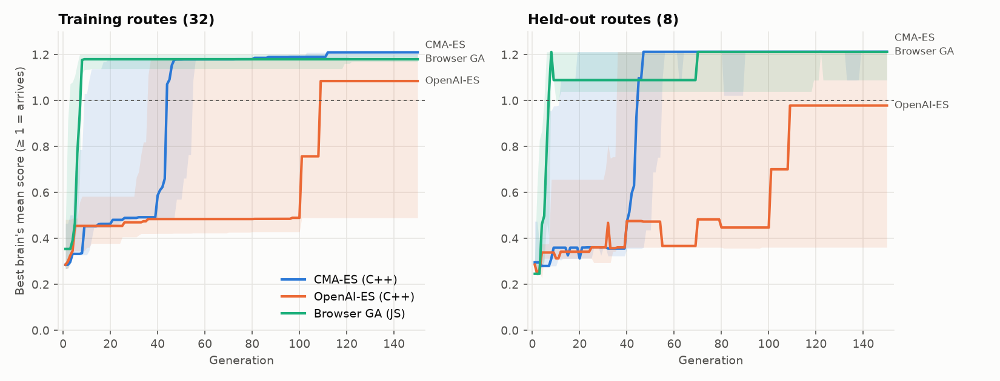
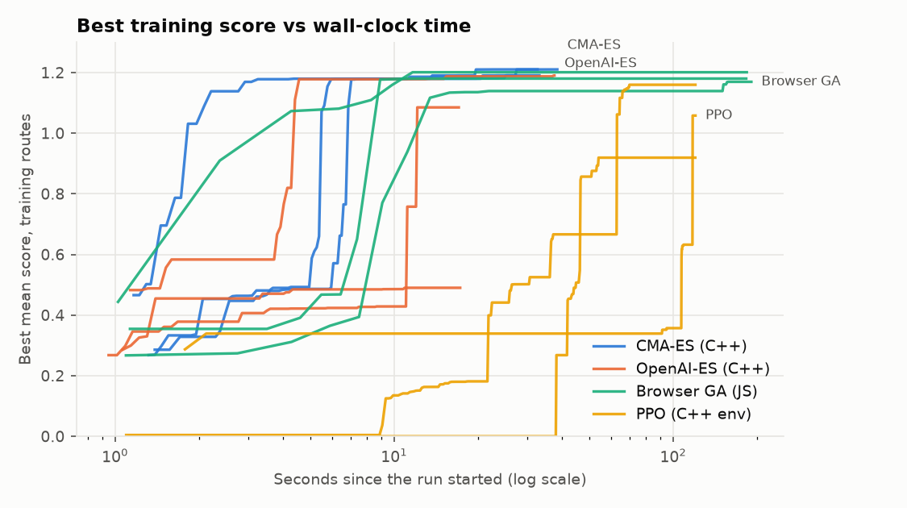
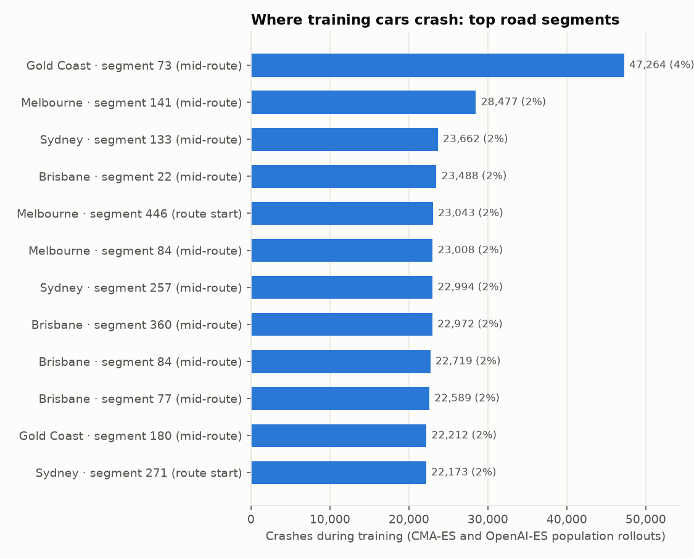
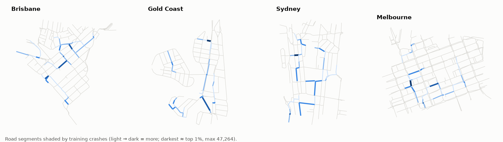

# Terra Trainer: training run analysis

Runs: cmaes-seed1, cmaes-seed2, cmaes-seed3, es-seed1, es-seed2, es-seed3, ga-seed1, ga-seed2, ga-seed3, ppo-seed1, ppo-seed2, ppo-seed3.

Scores are Bootcamp scores averaged over routes: the fraction of the route driven, or 1 + a time bonus when the car arrives, so ≥ 1 means it completes. Each run's *best* brain is tracked; 1.1 means nearly every route is completed.

## Algorithms compared

| Algorithm | Seeds | Gens / updates | Train (median) | Train range | Held-out (median) | Held-out range | Reached 1.1 | Gens to 1.1 | Seconds to 1.1 | Seconds total |
| --- | ---: | ---: | ---: | --- | ---: | --- | --- | ---: | ---: | ---: |
| CMA-ES (C++) | 3 | 150 | 1.210 | 1.191–1.210 | 1.213 | 1.212–1.213 | 3/3 | 46 | 5.8 | 33.2 |
| OpenAI-ES (C++) | 3 | 150 | 1.085 | 0.490–1.190 | 0.979 | 0.361–1.212 | 1/3 | 36 | 4.4 | 17.2 |
| Browser GA (JS) | 3 | 150 | 1.180 | 1.169–1.201 | 1.212 | 1.090–1.212 | 3/3 | 8 | 8.9 | 183.6 |
| PPO (C++ env) | 3 | 547 | 1.058 | 0.919–1.160 | 1.053 | 0.735–1.203 | 1/3 | 295 | 64.4 | 120.1 |

**Takeaways**

- **Wall-clock:** CMA-ES (C++) reached 1.1 on every seed, in a median 5.8 s; the browser GA in Node took 8.9 s (1.5× longer). Full runs: 33 s vs 184 s.
- **Per generation:** the browser GA needed a median 8 generations to reach 1.1, CMA-ES (C++) 46. The GA's elitism and spread mutation are a strong baseline; the speed-up comes from the C++ sim running every car in parallel, not from a smarter optimiser.
- **OpenAI-ES (C++)** reached 1.1 on 1/3 seeds (training range 0.490–1.190): from a random brain its gradient estimate often stalls on the step network's flat plateaus; it does well fine-tuning a good brain (`--algo es --init factory --sigma 0.1 --lr 0.02`).
- **PPO (C++ env)** reached 1.1 on 1/3 seeds (training range 0.919–1.160): it learns from scratch within its time budget, but the deterministic brain it exports swings between updates (its `train_score` column in generations-all.csv), so the best one is kept.

## Crash hotspots by road segment

1,175,300 crashes across every CMA-ES and OpenAI-ES population rollout, located on the map graph segment under the car. The top 12 segments hold 26% of them. By position on the route: mid-route 69%, route start 26%, route end 5%. Counts include every brain tried, from the first random generation onwards.

| Map | Segment | Where | Crashes | Share | Length (m) | Position (x, y) |
| --- | ---: | --- | --- | --- | ---: | --- |
| Gold Coast | 73 | mid-route | 47,264 | 4.0% | 78 | 1,206, -4,026 |
| Melbourne | 141 | mid-route | 28,477 | 2.4% | 110 | -2,752, 1,468 |
| Sydney | 133 | mid-route | 23,662 | 2.0% | 72 | -1,480, -862 |
| Brisbane | 22 | mid-route | 23,488 | 2.0% | 15 | -122, 536 |
| Melbourne | 446 | route start | 23,043 | 2.0% | 165 | -200, 1,657 |
| Melbourne | 84 | mid-route | 23,008 | 2.0% | 20 | -1,394, 3,642 |
| Sydney | 257 | mid-route | 22,994 | 2.0% | 27 | -2,142, 5,236 |
| Brisbane | 360 | mid-route | 22,972 | 2.0% | 114 | 680, -590 |
| Brisbane | 84 | mid-route | 22,719 | 1.9% | 222 | -204, 1,429 |
| Brisbane | 77 | mid-route | 22,589 | 1.9% | 90 | -2,046, 2,940 |
| Gold Coast | 180 | mid-route | 22,212 | 1.9% | 299 | 878, 3,440 |
| Sydney | 271 | route start | 22,173 | 1.9% | 226 | -1,116, 4,740 |

## Simulation speed

1,280 Bootcamp episodes (517,511 car-steps) on brisbane, arm64 · Darwin · 8 cores.

| Runtime | Car-steps / s | Cars at 60 fps | vs Node |
| --- | ---: | ---: | ---: |
| C++ (1 thread) | 1,161,929 | 19,365 | 3.3× |
| C++ (8 threads) | 6,140,802 | 102,347 | 17.7× |
| JS · node v22.23.3 | 346,933 | 5,782 | 1.0× |
| JS · HeadlessChrome/156.0.8078.4 | 392,351 | 6,539 | 1.1× |
